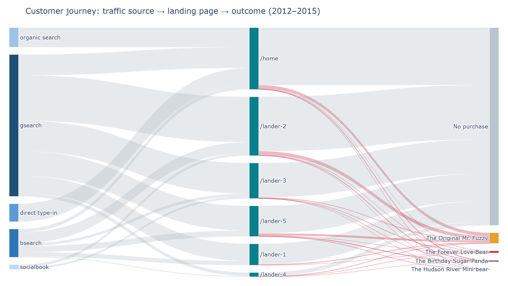
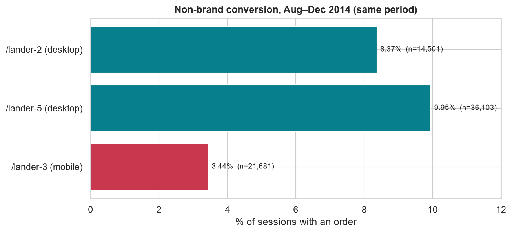

# Customer Journey Sankey Analysis: From Click to Checkout

[](https://github.com/Haven-Pham/customer-journey-sankey-analysis/actions/workflows/ci.yml)


## Overview

Marketing sees traffic sources, the web team sees landing pages, and finance sees orders. This project joins 472,871
sessions, 1.19 million page views and 32,313 orders from an online stuffed-toy retailer (March 2012 to March 2015)
into one journey, **traffic source → landing page → outcome**, and draws it as a multi-stage Sankey diagram. It then
tests which landing pages really convert best once traffic type, device and time period are held constant.

**Summary of results.** The `/home` page receives all brand and untagged traffic, while the `/lander-*` pages receive
only paid non-brand traffic, so a raw page ranking is misleading. Site-wide conversion also doubled between 2012
(4.1%) and 2015 (8.4%), which flatters landing pages launched later. On a fair same-period comparison for desktop
non-brand traffic, `/lander-5` converts at 9.95% against 8.37% for `/lander-2`, a gain of +1.57 percentage points
(95% CI +1.03 to +2.12). Mobile non-brand traffic converts at only 3.4%.



An interactive version of the diagram is saved as [`reports/journey_sankey.html`](reports/journey_sankey.html).

## Business Questions

1. How do traffic sources flow through landing pages to orders?
2. Which landing pages convert best on a fair comparison?
3. How should traffic routing and landing-page strategy change?

## Approach

- **One row per journey.** The landing page is the first page view of each session. Untagged sessions are split into
  organic search and direct type-in using `http_referer`, so every stage of the Sankey covers every session.
- **Source performance.** Conversion by source and campaign.
- **Fair landing-page test.** The analysis maps when each page was live and its device mix. It then compares pages
  that ran in the same window (August to December 2014) for the same traffic (non-brand) and device, with a 95%
  confidence interval for the difference.

## Key Findings

| Landing page | Live | Sessions | Overall conversion | Note |
|---|---|---:|---:|---|
| `/home` | 2012–2015 | 137,576 | 7.1% | Brand, organic and direct traffic |
| `/lander-1` | Jun 2012 – Mar 2013 | 47,574 | 4.5% | Ran when the site converted at about 4% |
| `/lander-2` | Jan 2013 – Dec 2014 | 131,170 | 7.7% | Desktop non-brand |
| `/lander-3` | Jul 2013 – Mar 2015 | 79,000 | 3.4% | Mobile only |
| `/lander-5` | Aug 2014 – Mar 2015 | 68,166 | 10.2% | Desktop non-brand |

**Same period, same traffic (non-brand, Aug–Dec 2014):**

| Page | Device | Sessions | Conversion |
|---|---|---:|---:|
| `/lander-5` | desktop | 36,103 | 9.95% |
| `/lander-2` | desktop | 14,501 | 8.37% |
| `/lander-3` | mobile | 21,681 | 3.44% |

- Sources convert within 6.7–8.9%, led by brand search. The `socialbook` pilot campaign converts at about 1%.
- About 93% of sessions end without a purchase. Mr. Fuzzy accounts for about two thirds or more of the orders from
  every landing page.



## Recommendations

1. **Roll `/lander-5` out to all desktop non-brand traffic.** It gains about 1.6 percentage points over `/lander-2`.
2. **Prioritise mobile.** Mobile converts at about a third of the desktop rate. A mobile version of the best lander,
   A/B-tested against `/lander-3`, is the largest opportunity in the journey.
3. **Stop or redesign the `socialbook` pilot.**
4. **Evaluate landing pages with concurrent A/B splits.** Because site-wide conversion rises every year, comparing
   one period with another overstates newer pages.

## Repository Structure

```text
customer-journey-sankey-analysis/
├── data/                    orders, products, sessions and page views (gzip) with data dictionary
├── notebooks/               customer_journey_sankey.ipynb (analysis with outputs)
├── reports/
│   ├── journey_sankey.html  interactive Sankey diagram
│   ├── figures/             Sankey, landing-page timeline, fair comparison
│   └── tables/              conversion by source, landing pages, fair comparison (CSV)
├── scripts/run_notebook.py  re-executes the notebook
└── requirements.txt
```

## Reproducing the Analysis

```bash
pip install -r requirements.txt
python scripts/run_notebook.py
```

Exporting the static Sankey image uses Kaleido, which requires a local Chrome or Chromium installation.

## Data

The *Maven Fuzzy Factory* e-commerce dataset (Maven Analytics), a public, fictional dataset for analytics training.
Field definitions are in [`data/README.md`](data/README.md).

## Limitations

- Attribution is per session and last-touch.
- The fair comparison covers one five-month window and non-brand traffic only.
- Because the data are fictional, the findings illustrate the method.

## Author

Pham Hong Hieu (Haven) · [Portfolio](https://haven-portfolio02.vercel.app) · [LinkedIn](https://www.linkedin.com/in/havenpham) · [GitHub](https://github.com/Haven-Pham)
